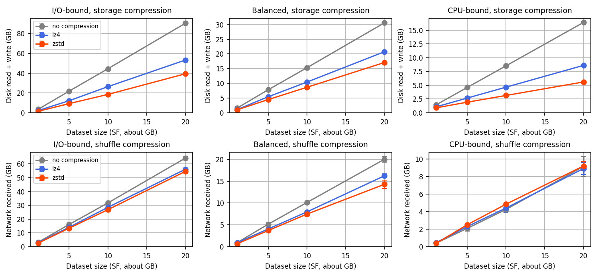
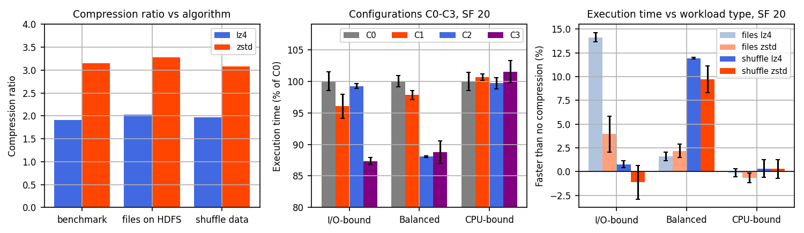

**Group:** *2*, USTH / INP-ENSEEIHT, M2 Cloud and Big Data\
**Code, raw measurements and scripts:** repository `CloudBigdataProject`

## 1. Introduction

When data is compressed, there is less data to read, write and send over the network, but the CPU has to
compress and decompress it. In this project we wanted to see when compression makes a Spark job faster and when
it makes it slower. We tested compression at two levels, as asked in the assignment. The first one is the
storage level, where the input and output files in HDFS are compressed. The second one is the communication
level, where the data exchanged between tasks during the shuffle is compressed.

For the parts that were left open, we made the following choices. We used Spark in standalone mode with HDFS,
because in Spark the shuffle compression can be set separately from the file compression. We built a cluster of
8 machines on AWS EC2 with Terraform and Ansible. We wrote three Spark jobs in Java: one I/O-bound, one
CPU-bound and one balanced. Among the four proposed codecs we chose two, LZ4 and Zstd, because both of them can
be used for files and for the shuffle, and we compared them with no compression. We used datasets of 1, 5, 10
and 20 GB and ran each configuration 3 times, so 216 runs in total.

## 2. Experimental infrastructure

{width=90%}

The cluster has 8 machines of type `m7i-flex.large` (2 vCPU, 8 GB of RAM, 100 GB disk) in the same availability
zone. The master runs the HDFS NameNode, the Spark Master, the History Server and the driver of the jobs. Each
of the 7 workers runs an HDFS DataNode and a Spark executor with 2 cores and 3 GB of memory. We use Hadoop 3.4.1
(only HDFS, with 3 replicas) and Spark 3.5.5 with the default settings, except the executor memory (3 GB
instead of the default 1 GB). Terraform creates the machines and Ansible
installs and starts Hadoop and Spark, so the same cluster can be created again with `make up`.

For the monitoring, `sar` records the CPU, memory, disk and network usage of every machine each second. The
Spark History Server gives for each job the execution time, the CPU time of all the tasks (this time includes
the compression work), the size of the shuffle data and the shuffle time.

## 3. Applications and workloads

We generate the `lineitem` and `orders` tables of the TPC-H benchmark as text files (SF 1 is 0.94 GB). Each size
is stored three times in HDFS: without compression, with LZ4 and with Zstd.

| Application | Processing |
|---|---|
| I/O-bound | sort the whole `lineitem` table by ship date and write it back |
| CPU-bound | apply SHA-256 64 times to every line, keep the largest hash per ship mode |
| Balanced | join `lineitem` and `orders`, compute the revenue and SHA-256 8 times per line, sum per customer |

| SF 20, no compression | Time | CPU share | CPU busy | I/O wait | Memory | Disk | Network | Shuffle |
|---|---|---|---|---|---|---|---|---|
| I/O-bound | 118 s | 0.55 | 63 % | 8.4 % | 28 % | 90.4 GB | 64.2 GB | 17.3 GB |
| Balanced | 168 s | 0.79 | 76 % | 2.2 % | 36 % | 30.6 GB | 20.0 GB | 10.9 GB |
| CPU-bound | 453 s | 0.98 | 82 % | 0.3 % | 18 % | 16.4 GB | 9.1 GB | 0.0 GB |

*Table 1. Characterisation of the workloads (CPU share is the CPU time divided by the running time of the tasks).*

Table 1 shows that the three jobs have the expected profiles. The CPU-bound job uses the CPU 98 % of the time and
has almost no shuffle. The I/O-bound job moves the most data and has the highest I/O wait. The balanced job is
between the two. The memory was never a limit (38 % at most).

## 4. Compression algorithms

For the storage level, the jobs write their output with a Hadoop codec, for example
`saveAsTextFile(path, Lz4Codec.class)`, and when a file is read Hadoop finds the codec from its extension. For
the shuffle, we start Spark with `spark.shuffle.compress=true` and `spark.io.compression.codec=lz4` (or `zstd`).
Zstd uses level 3 for the files, which is the default of Hadoop, and level 1 for the shuffle, which is the
default of Spark.

To measure the characteristics of the two codecs alone, we compress and decompress one `lineitem` file of 75 MB
in memory, with one thread and with the codec classes of Spark. We keep the median of 5 runs. Since there is only
one thread and no disk access, the measured time is CPU time.

| Codec | Ratio | Compression time | Decompression time | Compression speed |
|---|---|---|---|---|
| LZ4 | 1.91 | 0.24 s | 0.10 s | 316 MB/s |
| Zstd level 1 | 3.15 | 0.30 s | 0.10 s | 252 MB/s |
| Zstd level 3 | 3.22 | 0.42 s | 0.12 s | 181 MB/s |

*Table 2. Codec micro-benchmark on 75.8 MB of text.*

With Zstd the data is 40 % smaller than with LZ4, but the compression takes 25 % more time at level 1 and 75 %
more at level 3.

## 5. Methodology

We ran three experiments. In E1 only the files are compressed (none, LZ4 or Zstd). In E2 only the shuffle is
compressed (off, LZ4 or Zstd). In E3 we compare C0 (none/off), C1 (Zstd/off), C2 (none/LZ4) and C3 (Zstd/LZ4),
where the first codec is for the files and the second one for the shuffle. This gives 6 configurations, 3
applications, 4 sizes and 3 repetitions, so 216 runs. Before each run, a Python script empties the page cache of
all the machines and starts `sar`. After the run, it reads the metrics from `sar` and from the History Server.
The runs are done in a random order (with a fixed seed), so that a slow period of the cluster does not affect
only one codec. Between the 3 repetitions the execution time changes by 1.3 % in median and 5.7 % at most. The
graphs show the mean of the 3 runs, with the standard deviation as error bars.

## 6. Results

{width=88%}

{width=88%}

{width=88%}

### 6.1 Storage compression (E1)

The files are 2.0 times smaller with LZ4 and 3.3 times smaller with Zstd. At SF 20, the 19.1 GB of data become
9.4 GB with LZ4 and 5.8 GB with Zstd. The disk volume goes down for every job (Figure 4) but the CPU time goes up
(Figure 3). Only the I/O-bound job becomes faster. At SF 20, LZ4 reduces its disk volume from 90.4 GB to 53.3 GB
and its disk throughput from 765 to 525 MB/s, and adds 106 s of CPU time (from 821 s to 927 s). The job is then
14 % faster. Its I/O wait goes down from 8.4 % to 1.6 % and its CPU usage goes up from 63 % to 75 %. Zstd reduces
the disk volume even more (39.4 GB) but adds 268 s of CPU time, so the gain is only 4 %. The two other jobs are not faster. So the reduction of disk I/O is enough to pay for the extra CPU with LZ4, only
partly with Zstd, and not at all for the balanced and CPU-bound jobs.

### 6.2 Communication compression (E2)

For the balanced job, LZ4 reduces the shuffle data from 10.9 GB to 6.0 GB and Zstd to 4.1 GB. The network volume
goes from 20.0 GB to 16.2 GB and 14.3 GB (Figure 4), and the network throughput from 119 MB/s to 110 and 95 MB/s.
We expected the CPU time to increase, but it decreased (from 1722 s to 1499 s with LZ4), and the shuffle time
was divided by 2 (from 28.3 s to 15.2 s). Writing and sending half of the data saved more CPU than the
compression cost. Since the balanced job is limited by its CPU (CPU share 0.79 and 2.2 % I/O wait in Table 1), it is 12 % faster. The I/O-bound job also uses
less CPU (from 821 s to 712 s) but it is not faster. In both jobs the tasks waited less than 1 s in total for
remote shuffle data, so the network was not the bottleneck. Shuffle compression made the jobs slower in three
cases: Zstd for the I/O-bound job at SF 10 and SF 20 (1 % slower), both codecs for the I/O-bound job at SF 1,
and the CPU-bound job, where the very small shuffle (about 100 bytes per task) became bigger after compression.

### 6.3 Combined compression (E3) and workload type

The compression ratios measured on the cluster are close to the ones of the micro-benchmark (Figure 5, left).
For the I/O-bound job, C3 is the fastest configuration, with 87 % of the time of C0. With Zstd files the job is
limited by the CPU (75 % CPU busy, 1.2 % I/O wait), so the CPU saved by the shuffle compression reduces its time (from 113.5 s with C1 to 103.3 s
with C3). For the balanced job, C3 is up to 2.5 % slower than C2, and for the CPU-bound job C3 is the slowest
configuration (+1.5 %). Each job is only faster when compression is applied where its bottleneck is
(Figure 5, right).

### 6.4 Effect of the dataset size

| Gain (LZ4 / Zstd) | SF 1 | SF 5 | SF 10 | SF 20 |
|---|---|---|---|---|
| I/O-bound, files | -1 / -3 % | +3 / -5 % | +10 / +1 % | +14 / +4 % |
| Balanced, shuffle | +7 / +5 % | +9 / +8 % | +10 / +7 % | +12 / +10 % |
| Balanced, files | -2 / -3 % | +2 / -1 % | +2 / -1 % | +2 / +2 % |
| I/O-bound, shuffle | -2 / -1 % | +5 / 0 % | +2 / -1 % | +1 / -1 % |
| CPU-bound, all | -1 to +2 % | -2 to -1 % | 0 to +1 % | -1 to 0 % |

*Table 3. Gain in execution time compared to no compression (a negative value means slower).*

## 7. Answers to the questions

1. Which algorithm gives the best trade-off between compression ratio and CPU overhead? In our measurements it
   was LZ4. Zstd removes 40 % more bytes, but it was slower than LZ4 every time the difference was bigger than
   the variation between runs (113.5 s against 101.5 s for the I/O-bound files, and 151.3 s against 147.6 s for
   the balanced shuffle, at SF 20).
2. Does compression always improve I/O-bound applications? No. LZ4 files give +14 % but Zstd files only +4 %,
   shuffle compression gives nothing, and at SF 1 all configurations are 1 to 3 % slower (Table 3).
3. How does compression affect CPU-bound applications? There is no benefit. All configurations are within 2 %,
   and C3 is the slowest one (+1.5 %).
4. How do the benefits change with the dataset size? They grow with the size (Table 3). The order of the codecs
   also changes. For the I/O-bound job, no compression is the fastest at SF 1, LZ4 is the fastest from SF 5, and
   Zstd is faster than no compression only from SF 10.
5. Is compression more useful for storage or for network communication? It depends on the job. The biggest gain
   came from storage compression (14 % for the I/O-bound job). Shuffle compression gave 12 % to the balanced job,
   reduced the CPU time of both jobs that have a shuffle, and never cost more than about 2 %.
6. Can compressing both levels make the performance worse? Yes, a little: up to 2.5 % slower than shuffle
   compression alone for the balanced job, and the slowest configuration for the CPU-bound job.
7. When should compression be disabled? For small datasets (SF 1), for CPU-bound jobs, for very small data (the
   CPU-bound shuffle got bigger), and when the CPU is already the bottleneck (Zstd files for the I/O-bound job).

## 8. Conclusion

On our cluster of 8 machines, compression reduced the execution time by up to 14 % when it reduced the data at
the bottleneck of the job, which was the output of the I/O-bound job (written 3 times by HDFS) or the shuffle of
the balanced job. It did not help, or made the job a little slower, for the CPU-bound job and for small
datasets. LZ4 was the best codec in all our measurements, and the shuffle compression even reduced the CPU time
of the jobs.
