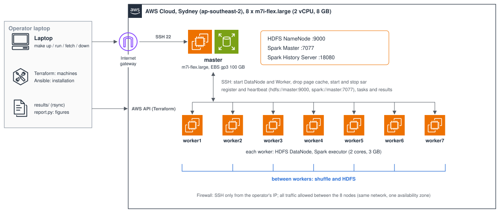
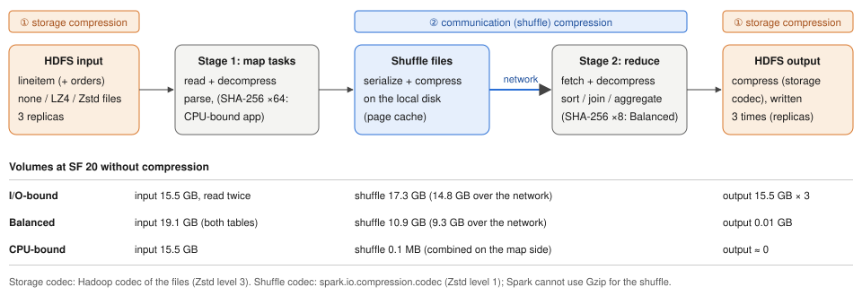
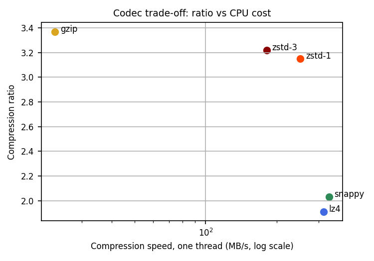
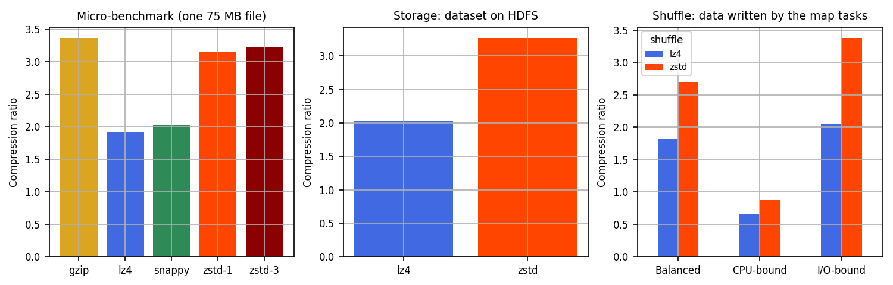
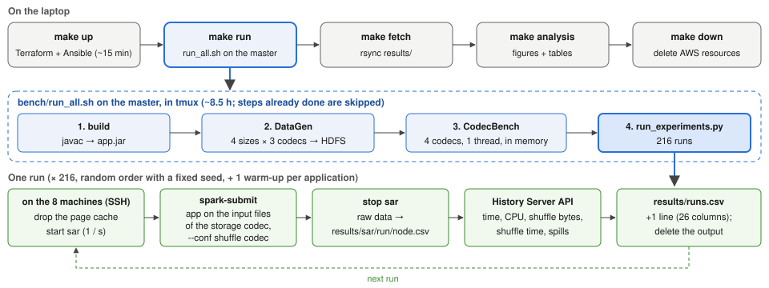
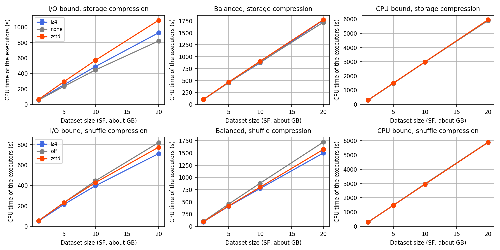
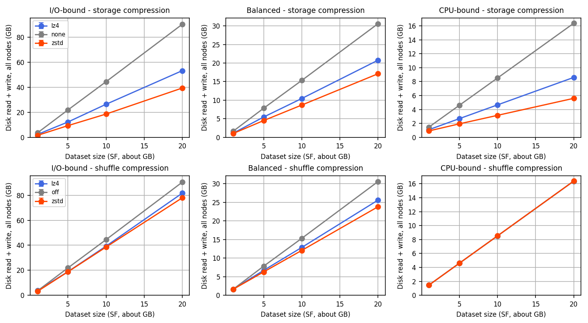
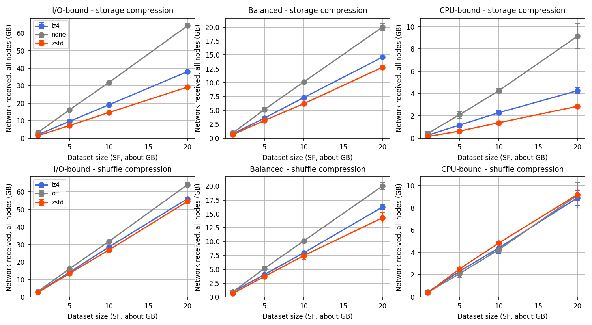
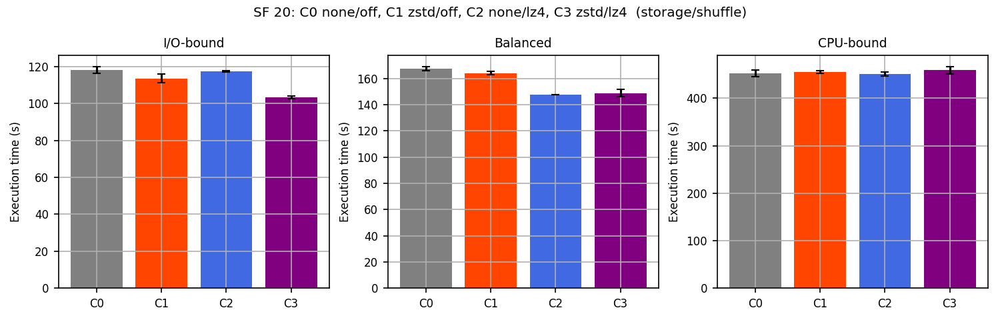
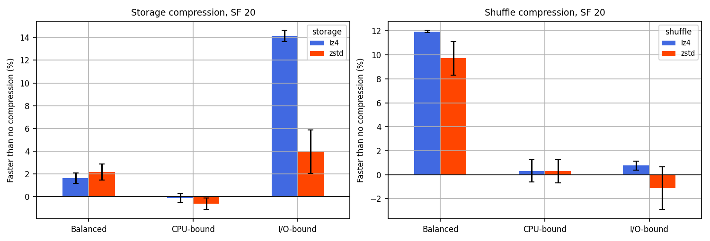

**Group:** *(names)* — USTH / INP-ENSEEIHT, M2 Cloud and Big Data\
**Code, raw measurements and scripts:** `CloudBigdataProject/` (this repository)

## Summary

We measured the gain and the cost of compression in Apache Spark at two levels - **storage** (text files on
HDFS) and **communication** (shuffle data) - on a cluster of 8 AWS EC2 machines (1 master + 7 workers),
with three applications of different profiles (I/O-bound, CPU-bound, balanced), four dataset sizes
(1, 5, 10, 20 GB), two codecs on the cluster (LZ4, Zstd) plus the baseline without compression, and 3
repetitions of every configuration: **216 runs, all successful, with a median coefficient of variation of
1.3 %**. The four codecs of the assignment (Gzip, Snappy, LZ4, Zstd) were first compared on one machine.

Main findings:

1. **The codecs form two families.** LZ4 and Snappy compress little (≈ 2×) but fast (> 300 MB/s per core);
   Zstd and Gzip compress ≈ 3.2–3.4×, but Gzip is 11× slower than Zstd. **Zstd gives the best
   ratio/CPU trade-off; LZ4 the lowest CPU cost.**
2. **Compression helps only when it reduces the bytes of the actual bottleneck.** At 20 GB, storage
   compression with LZ4 makes the I/O-bound application **14 % faster**, shuffle compression with LZ4 makes
   the balanced application **12 % faster**; the CPU-bound application never changes by more than 1.5 %.
3. **Shuffle compression reduced the CPU time** of the executors (-13 % for both applications that
   shuffle): writing, copying and sending twice as many bytes cost more CPU than LZ4 compression.
4. **Benefits grow with the data size**: storage compression is slightly harmful at 1 GB (fixed costs
   dominate), then its gains grow; the gains of shuffle compression also grow with the size.
5. **Combining both levels does not simply add up**: for the balanced and CPU-bound jobs, C3 is slightly
   slower than the best single level; only the I/O-bound job gains from combining (-13 %).

## 1. Context and objectives

Spark and Hadoop jobs move large volumes of data: they read and write files on the distributed file
system (HDFS) and exchange intermediate data between tasks during the **shuffle** (between two stages,
e.g. around a sort, a join or a group-by). Compression reduces the number of bytes stored, read, written
and sent over the network, but costs CPU time to compress and decompress. The objective is to determine
experimentally **when compression improves or degrades performance**, depending on the codec, the
application, the data size and the level at which it is applied:

- **storage-level compression**: input and output files on HDFS are compressed;
- **communication-level compression**: shuffle data written by the map tasks and fetched by the reduce
  tasks is compressed.

## 2. Experimental infrastructure

| Component | Choice |
|---|---|
| Cloud | AWS, region Sydney (`ap-southeast-2`), one availability zone, private VPC |
| Machines | 8 × `m7i-flex.large` (2 vCPU, 8 GB RAM), Ubuntu 22.04, gp3 disk 100 GB each |
| Roles | master: HDFS NameNode, Spark Master, Spark History Server, driver of the jobs; workers 1–7: HDFS DataNode + Spark Worker |
| Software | Java 11, Hadoop 3.4.1 (HDFS only, 3 replicas, 128 MB blocks), Spark 3.5.5 standalone |
| Spark settings | defaults (one executor per worker using its 2 cores, Java serializer), except `spark.executor.memory = 3g` (the default 1 GB made large sizes spill to disk) |
| Monitoring | `sar` (sysstat) on the 8 machines, one sample per second: CPU, memory, disk, network; Spark History Server REST API: CPU time, bytes and time of the shuffle, spills, garbage collection |



**Reproducibility.** The whole infrastructure is code. **Terraform** creates the network, the firewall
(SSH only from the operator's IP, everything allowed between the nodes) and the machines; **Ansible**
installs Java, Hadoop and Spark with one shell script, writes `/etc/hosts` and the list of workers, sets
up password-less SSH from the master and starts HDFS, Spark and the History Server. Automatic Ubuntu
updates are disabled so that they do not disturb the measurements. Four commands run everything from a
laptop: `make up` (cluster), `make run` (the whole study, in `tmux` on the master), `make fetch` (results)
and `make down` (deletes every AWS resource). The same cluster and configuration were used for every run;
only the compression settings change.

**Note on the machines.** The account (AWS Free plan, 16 vCPU quota) only allows `m7i-flex` machines.
Their CPU is not limited by credits, but their disk (baseline 39 MB/s) and network (baseline 0.39 Gbps)
can burst above the baseline for a limited time. During the study the disks of the workers sustained
about 110 MB/s (read + write) during the I/O-bound runs: the I/O was **not saturated** (Section 8).

## 3. Workloads

### 3.1 Dataset

We generate the `orders` and `lineitem` tables of the TPC-H benchmark (business data: numbers, dates,
codes, short comments) as text files with `|`-separated columns. Text with repeated values compresses like
real data, and the two tables share a key, which allows a join. Every order has its own random generator
seeded with its key, so the data is identical whatever the number of machines, and the three copies of
each size (one per storage codec) have exactly the same content. Each file holds 150,000 orders
(≈ 75 MB of `lineitem`): it is smaller than one HDFS block, so that every codec gives the same number of
tasks (compressed text files cannot be split).

| Size (SF) | Not compressed | LZ4 | Zstd | Files per table |
|---|---|---|---|---|
| 1 | 0.94 GB | 0.47 GB | 0.29 GB | 10 |
| 5 | 4.74 GB | 2.35 GB | 1.45 GB | 50 |
| 10 | 9.52 GB | 4.70 GB | 2.91 GB | 100 |
| 20 | 19.10 GB | 9.39 GB | 5.82 GB | 200 |

*Table 1 — Size of the datasets on HDFS (both tables, one replica). `lineitem` is 80 % of it.*

### 3.2 Applications

All three are Spark jobs written in Java with the RDD API.

| Application | Processing | Expected profile |
|---|---|---|
| **I/O-bound** (`IoBound`) | sort the whole `lineitem` table by ship date (`sortByKey`) and write it back | all the data is read, shuffled and written; almost no computation |
| **CPU-bound** (`CpuBound`) | apply SHA-256 64 times to every line, keep the largest digest per ship mode (`reduceByKey`) | combined on the map side: the shuffle is a few kB; time spent hashing |
| **Balanced** (`Balanced`) | join `lineitem` and `orders` on the order key, compute the revenue and SHA-256 8 times per line, total per customer | large shuffle (both tables) and significant computation |

The number of tasks is Spark's default: one task per input file, then the same number of reduce tasks.

### 3.3 Characterisation of the workloads

Table 2 shows the runs **without compression** (C0) at 20 GB. *CPU share* = executor CPU time / task
time; *data moved per CPU second* = (input + shuffle written + shuffle read + output) / CPU time.

| Application | Time | CPU share | Data moved per CPU s | CPU busy | I/O wait | Memory used | Disk (r + w) | Network | Shuffle |
|---|---|---|---|---|---|---|---|---|---|
| I/O-bound | 118 s | 0.55 | 98.6 MB | 63 % | 8.4 % | 28 % | 90.4 GB | 64.2 GB | 17.3 GB |
| Balanced | 168 s | 0.79 | 23.7 MB | 76 % | 2.2 % | 36 % | 30.6 GB | 20.0 GB | 10.9 GB |
| CPU-bound | 453 s | 0.98 | 2.6 MB | 82 % | 0.3 % | 18 % | 16.4 GB | 9.1 GB | 0.1 MB |

*Table 2 — Workload characterisation, SF 20, no compression (mean of 3 runs; CPU busy, I/O wait and
memory: mean over the 8 machines, so the mostly idle master lowers them). Memory never exceeded 38 % and
no run spilled to disk, so memory was not a limiting resource.*

## 4. Compression algorithms

### 4.1 How compression is enabled

| Level | Mechanism | Codecs available |
|---|---|---|
| Storage | the job writes its files with a Hadoop codec: `rdd.saveAsTextFile(path, ZStandardCodec.class)`; when reading, Hadoop finds the codec from the file extension | Gzip, Snappy, LZ4, Zstd (level 3 by default) |
| Communication | Spark configuration: `spark.shuffle.compress`, `spark.shuffle.spill.compress`, `spark.io.compression.codec` | LZ4 (default), Snappy, Zstd (level 1 by default), LZF — **no Gzip** |

Without compression means `none` files and `spark.shuffle.compress=false`. Figure 2 shows where each
level acts in the jobs, and the volumes concerned for each application.



### 4.2 Intrinsic characteristics (micro-benchmark)

`bench/CodecBench.java` compresses and decompresses one `lineitem` file (75.8 MB) in memory, on one
thread of a cluster machine, with the codec classes used by Spark for the shuffle (Gzip: `java.util.zip`,
level 6, as Hadoop's `GzipCodec`). Each measurement is the median of 5 repetitions after 2 warm-up
repetitions. As the data is in memory and on one thread, the time is CPU time. A second input of 64 MB
of random bytes (incompressible) gives the worst case.

| Codec | Ratio | Compression | Decompression | Compression of random data |
|---|---|---|---|---|
| LZ4 | 1.91 | 316 MB/s | 735 MB/s | 788 MB/s |
| Snappy | 2.03 | 333 MB/s | 536 MB/s | 1743 MB/s |
| Zstd level 1 (shuffle) | 3.15 | 252 MB/s | 741 MB/s | 1283 MB/s |
| Zstd level 3 (files) | 3.22 | 181 MB/s | 643 MB/s | 1059 MB/s |
| Gzip level 6 | 3.37 | **23 MB/s** | 239 MB/s | 39 MB/s |

*Table 3 — Codec micro-benchmark (ratio = original size / compressed size; random data: ratio 1.00 for
every codec).*

{width=60%}

The codecs form **two families** (Figure 3): *fast with a low ratio* (LZ4, Snappy: ≈ 2×, > 300 MB/s) and
*high ratio* (Zstd, Gzip: 3.2–3.4×). Inside the second family, Zstd level 1 reaches 94 % of Gzip's ratio
and is **11× faster** to compress and 3× faster to decompress. On incompressible data, Gzip still costs
26 ms of CPU per MB for no gain, Zstd and Snappy less than 1 ms.

### 4.3 Codecs used on the cluster

To keep the cluster study readable and its cost reasonable, we used **one codec of each family** on the
cluster, both available at both levels: **LZ4** (fast, low ratio; Spark's default) and **Zstd** (high
ratio). Snappy behaves like LZ4 (Table 3), and Gzip cannot compress the shuffle in Spark; with LZ4 and Zstd
the *same* two codecs are compared in every experiment. The measured ratios on the cluster confirm the
micro-benchmark (Figure 4): 2.0× (LZ4) and 3.3× (Zstd) for the files, 1.8–2.1× and 2.7–3.4× for the
shuffle.



The CPU-bound job's shuffle (≈ 100 bytes per task) becomes **larger** with compression (ratio 0.65 with
LZ4, 0.87 with Zstd): for tiny data, the headers of the compressed blocks cost more than they save.

## 5. Methodology

**Configurations.** Each run is defined by (application, size, storage codec, shuffle codec, repetition).

| Experiment | Storage | Shuffle | Purpose |
|---|---|---|---|
| E1 — storage | none, LZ4, Zstd | off | Section 5.1 of the assignment |
| E2 — communication | none | off, LZ4, Zstd | Section 5.2 |
| E3 — combined | C0 none/off, C1 Zstd/off, C2 none/LZ4, C3 Zstd/LZ4 | | Section 5.3 |

C0, C1 and C2 are shared with E1 and E2, so there are 6 distinct configurations:
6 × 3 applications × 4 sizes × 3 repetitions = **216 runs**. For C3 we combined the high-ratio codec for
the data at rest with the fast codec for the data sent once over the network.

**Protocol of one run** (`bench/run_experiments.py`):

1. on every machine, through SSH: empty the page cache (so that data is really read from disk) and start
   `sar` (1 sample per second);
2. `spark-submit` the application with the compression settings;
3. stop `sar` and keep its raw output (`results/sar/<run>/<machine>.csv`, archived in `results/sar.tar.gz`);
4. read the metrics of the application from the History Server and add one line to `results/runs.csv`.



**Fairness.** The 216 runs were executed in a random order (fixed seed), so that a slower period of the
cluster does not fall on one codec; one warm-up run per application was not recorded; outputs are deleted
after each run. The variability is low: the coefficient of variation of the execution time is 1.3 % in
median and 5.7 % at most. Graphs show the mean of the 3 repetitions and the standard deviation as error bars.

**Metrics.** Execution time (History Server); CPU time = sum of the CPU time of all tasks (it includes the
compression and decompression work); disk = bytes read + written on the devices of the 8 machines (`sar`);
network = bytes received by the 8 machines (`sar`); shuffle time = shuffle write time + time waiting for
remote shuffle blocks; throughputs = volume / execution time (`analysis/tables/summary.csv`).

The study ran on 26–27 November 2026 and took about 8.5 hours (the cluster was up about 10 hours, ≈ 10 USD).

## 6. Results

### 6.1 Execution time vs dataset size


| | SF 1 | SF 5 | SF 10 | SF 20 |
|---|---|---|---|---|
| I/O-bound, files LZ4 | −1.1 | +2.5 | +9.5 | **+14.1** |
| I/O-bound, files Zstd | −2.6 | −4.7 | +1.0 | +3.9 |
| Balanced, files LZ4 / Zstd | −1.5 / −2.6 | +1.6 / −1.1 | +2.1 / −1.3 | +1.6 / +2.2 |
| Balanced, shuffle LZ4 | +6.8 | +8.6 | +10.2 | **+11.9** |
| Balanced, shuffle Zstd | +4.6 | +7.9 | +7.2 | +9.7 |
| I/O-bound, shuffle LZ4 / Zstd | −2.1 / −1.0 | +4.6 / +0.2 | +1.7 / −1.4 | +0.8 / −1.1 |
| CPU-bound, all codecs and levels | within ±2 | within ±2 | within ±1.2 | within ±0.6 |

*Table 4 — % faster than without compression (negative = slower).*

**Does the ranking of the codecs change with the size?** Yes, for storage compression. For the I/O-bound
job, no compression is the fastest option at SF 1, LZ4 becomes the fastest from SF 5, and Zstd, slower than
no compression up to SF 5, overtakes it from SF 10: the larger the data, the more the saved I/O outweighs
the CPU cost, and the later a costly codec becomes profitable. For the balanced job the three storage options
stay within 3 % and their order changes with the size (noise level). For shuffle compression the ranking of
the balanced job is the same at every size (LZ4 fastest, then Zstd, then no compression) and only the gap grows.

### 6.2 Storage-level compression (E1)

| SF 20 | Time | CPU time | Input read | Output written | Disk (r + w) | Network |
|---|---|---|---|---|---|---|
| I/O-bound none | 118.2 s | 821 s | 30.9 GB | 15.5 GB | 90.4 GB | 64.2 GB |
| I/O-bound LZ4 | **101.5 s** | 927 s (+13 %) | 15.5 GB | 7.3 GB | 53.3 GB (−41 %) | 38.0 GB (−41 %) |
| I/O-bound Zstd | 113.5 s | 1089 s (+33 %) | 9.5 GB | 4.5 GB | 39.4 GB (−56 %) | 29.2 GB (−55 %) |
| Balanced none | 167.6 s | 1722 s | 19.1 GB | 0 | 30.6 GB | 20.0 GB |
| Balanced LZ4 / Zstd | 164.9 / 164.0 s | +3 % | 9.4 / 5.8 GB | 0 | 20.8 / 17.1 GB | 14.6 / 12.8 GB |
| CPU-bound none / LZ4 / Zstd | 452.5 / 453.1 / 455.4 s | +0.6 / +1.0 % | 15.5 / 7.7 / 4.8 GB | 0 | 16.4 / 8.6 / 5.6 GB | 9.1 / 4.3 / 2.9 GB |

*Table 5 — Storage compression at SF 20 (`input` is read twice by the sort: once to sample the keys).*

| SF 20 | CPU busy | I/O wait | Disk throughput | Network throughput |
|---|---|---|---|---|
| I/O-bound none / LZ4 / Zstd | 63 / 75 / 75 % | 8.4 / 1.6 / 1.2 % | 765 / 525 / 347 MB/s | 544 / 375 / 257 MB/s |
| Balanced none / LZ4 / Zstd | 76 / 78 / 79 % | 2.2 / 0.8 / 0.8 % | 183 / 126 / 104 MB/s | 119 / 89 / 78 MB/s |
| CPU-bound none / LZ4 / Zstd | 82 / 82 / 82 % | 0.3 / 0.3 / 0.3 % | 36 / 19 / 12 MB/s | 20 / 9 / 6 MB/s |

*Table 5b — CPU utilisation and I/O throughput (sum over the 8 machines) with storage compression, SF 20.*





Storage compression always reduces the bytes read, written and sent, in proportion to the compression
ratio (Figures 8 and 9), and always costs CPU (Figure 7). It pays off only for the I/O-bound job, whose output
(15.5 GB, written 3 times by HDFS) is its bottleneck: LZ4 removes 37 GB of disk I/O and 26 GB of network
for 106 s of extra CPU spread over 14 cores, and the job is 14 % faster. Zstd removes even more bytes,
but its compression (level 3, 181 MB/s) costs 268 s of CPU: the CPU becomes the limit and only 4 % is
left. For the balanced and CPU-bound jobs, reading fewer bytes does not change the time, because reading
is not what limits them. Table 5b shows the shift of the bottleneck: with compressed files the I/O-bound job
waits much less for I/O (I/O wait 8.4 % → 1.6 %) and uses the CPU more (63 % → 75 %), while its disk and
network throughputs drop by a third: **reducing disk I/O compensated the extra CPU cost with LZ4, only
partly with Zstd, and not at all for the two other applications.**

### 6.3 Communication-level compression (E2)

| SF 20 | Time | CPU time | Shuffle written | Shuffle over network | Shuffle time | Fetch wait | Network |
|---|---|---|---|---|---|---|---|
| Balanced off | 167.6 s | 1722 s | 10.9 GB | 9.3 GB | 28.3 s | 0.02 s | 20.0 GB |
| Balanced LZ4 | **147.6 s** | 1499 s (−13 %) | 6.0 GB | 5.1 GB | 15.2 s | 0.02 s | 16.2 GB |
| Balanced Zstd | 151.3 s | 1572 s (−9 %) | 4.1 GB | 3.5 GB | 12.8 s | 0.03 s | 14.3 GB |
| I/O-bound off | 118.2 s | 821 s | 17.3 GB | 14.8 GB | 42.4 s | 0.69 s | 64.2 GB |
| I/O-bound LZ4 | 117.3 s | 712 s (−13 %) | 8.3 GB | 7.1 GB | 19.7 s | 0.89 s | 56.1 GB |
| I/O-bound Zstd | 119.5 s | 775 s (−6 %) | 5.1 GB | 4.4 GB | 13.5 s | 0.22 s | 54.6 GB |
| CPU-bound off / LZ4 / Zstd | 452.5 / 451.0 / 451.2 s | ≈ | 0.1 MB | — | 0.03 s | — | 9.1 GB |

*Table 6 — Shuffle compression at SF 20 (shuffle time = total over all tasks). Shuffle network throughput
(shuffle bytes over the network / time): balanced 56 → 35 (LZ4) / 23 (Zstd) MB/s, I/O-bound 125 → 61 / 36 MB/s;
total network throughput in `analysis/tables/summary.csv`.*



Shuffle compression halves (LZ4) or divides by three (Zstd) the shuffle bytes, and **reduces the total
CPU time** instead of increasing it. Spark serializes the shuffle records with the Java serializer, which
produces verbose and very redundant bytes; compressing them with LZ4 costs less CPU than writing, copying
and sending twice as many bytes through the operating system and the network stack (the CPU time measured
includes this system time; the shuffle write time is divided by 2). Zstd compresses more but costs more
CPU than LZ4, so it saves less CPU and less time. The time waiting for remote blocks is always below 1 s:
**the network was never the bottleneck of the shuffle**.

The balanced job, whose time is driven by its CPU (CPU share 0.79), turns the CPU saved into 12 % of time.
The I/O-bound job saves as much CPU but no time: its bottleneck is the output written to HDFS, which shuffle
compression does not change (its network traffic is dominated by the output replication and remote reads).
So reducing the network traffic improved the performance only when the job was limited by the work of
moving the shuffle, not by the network itself.

**When shuffle compression is counterproductive.** Zstd on the I/O-bound shuffle is 1.1–1.4 % slower at
SF 10–20 (it costs more CPU than LZ4 for a job that is not limited by the shuffle); at SF 1 both codecs make
the I/O-bound job 1–2 % slower; and the CPU-bound job's tiny shuffle grows with compression (ratio 0.65).

### 6.4 Combined compression (E3)



| Time (s) | C0 none/off | C1 Zstd/off | C2 none/LZ4 | C3 Zstd/LZ4 |
|---|---|---|---|---|
| I/O-bound SF 10 / 20 | 65.8 / 118.2 | 65.1 / 113.5 | 64.7 / 117.3 | **61.0 / 103.3** |
| Balanced SF 10 / 20 | 91.8 / 167.6 | 93.0 / 164.0 | **82.4 / 147.6** | 84.5 / 148.8 |
| CPU-bound SF 10 / 20 | 241.1 / 452.5 | 240.9 / 455.4 | 239.7 / 451.0 | 241.3 / 459.3 |

*Table 7 — Combined compression (all sizes: `analysis/tables/summary.csv`).*

For the I/O-bound job, C3 is the best configuration (−13 % at SF 20) and better than each level alone:
Zstd storage makes the job CPU-limited (Section 6.2), and the CPU saved by shuffle compression then turns
into time (−9 % between C1 and C3), which it did not do in C2. For the balanced job, adding Zstd files to
LZ4 shuffle (C3 vs C2) costs 1–2.5 % from SF 5 to SF 20. For the CPU-bound job, C3 is the slowest configuration
(+1.5 %): it pays both decompression costs and gains nothing.

### 6.5 Execution time vs workload type



Each application benefits from compression at the level where its bottleneck is: the I/O-bound job from
storage compression (its output), the balanced job from shuffle compression (its CPU spent on the large
shuffle), and the CPU-bound job from neither.

## 7. Analysis: answers to the questions

**1. Which algorithms give the best trade-off between compression ratio and CPU overhead?**
Zstd at a low level: 94 % of Gzip's ratio at 11× its speed (Table 3), and on the cluster it removes 30–40 %
more bytes than LZ4 for a moderate CPU cost. LZ4 (and Snappy) have the lowest CPU cost, which made LZ4 the
fastest choice, or within 1 % of it, in every configuration we measured, because the I/O of our cluster was not saturated (Tables
5, 6). Gzip is dominated: Zstd compresses almost as much for a fraction of the CPU, and Gzip is not even
available for the shuffle.

**2. Does compression systematically improve the performance of I/O-bound applications?**
No. Storage compression with LZ4 makes the I/O-bound job 14 % faster at 20 GB, Zstd only 4 %; shuffle
compression does not change its time (±2 %); and at 1 GB every configuration is 1–3 % *slower* (Table 4).
The gain requires (a) that the bytes removed are those of the bottleneck (here the replicated output, not
the shuffle), (b) a codec cheap enough not to make the CPU the new bottleneck, and (c) enough data.

**3. How does compression affect CPU-bound applications?**
It has no measurable benefit and a small cost: −1.9 % to +2.1 % for every codec, level and size, within the
noise, and Zstd files + LZ4 shuffle (C3) is the slowest configuration (+1.5 %). Compression even
increased its tiny shuffle (ratio 0.65). The time is spent hashing, and the extra decompression work
(≈ 1 % of the CPU time with Zstd) is negligible.

**4. How do the benefits of compression evolve with increasing dataset sizes?**
They increase. At SF 1 storage compression is neutral or harmful for every job (fixed costs of the job and
of the codecs dominate, and the 10 tasks of SF 1 do not even use the 14 cores); its gains appear at
SF 5–10. The gain of shuffle compression for the balanced job grows from 7 % (SF 1) to 12 % (SF 20). The
largest gains are at SF 20, with no sign of levelling off: +14 % (I/O-bound, LZ4 files) and +12 %
(balanced, LZ4 shuffle).
The volumes saved are proportional to the size (Figures 8, 9), while part of the time is constant.

**5. Is compression more beneficial for storage operations or network communications?**
It depends on the application. On our cluster, the largest single gain came from storage compression
(I/O-bound, −14 %), because the output is written three times by HDFS; shuffle compression helped the
balanced job (−12 %), never cost more than 2 % for the jobs with a large shuffle, and reduced their CPU
time. Shuffle compression is the safer default (it is on by default in Spark with
LZ4); storage compression pays off for jobs dominated by reading or writing large files.

**6. Can combining storage and communication compression degrade performance?**
Yes, slightly: for the balanced job C3 is up to 2.5 % slower than shuffle compression alone (SF 5–20), and for the CPU-bound
job C3 is the slowest configuration. The two levels do not add up: C3 is never much better than the best
single level, except for the I/O-bound job, where shuffle compression compensates the CPU cost of Zstd files.

**7. Under which conditions should compression be disabled?**
For storage compression of small data (≤ 1 GB here: 1–3 % slower); for CPU-bound jobs, which gain nothing; when the data is
already compressed or random (Table 3: ratio 1.00, Gzip then spends 26 ms of CPU per MB for nothing) or
when the shuffle is tiny (compression increased it); and when the CPU is already the bottleneck, where a
slow codec (Zstd level 3, and even more Gzip) turns saved bytes into lost time (I/O-bound with Zstd files).

## 8. Limitations and threats to validity

- **I/O not saturated.** The `m7i-flex` disks and network can burst above their baseline, and the long
  CPU-bound runs let their credits recover; the disks sustained ≈ 110 MB/s per worker and the shuffle
  never waited for the network. On a cluster with slower disks or network the gains of compression would be
  larger, and Zstd could overtake LZ4.
- **Data locality.** About 60 % of the HDFS blocks were read from a remote DataNode, so the network volume
  includes HDFS reads and output replication, not only the shuffle. Shuffle traffic alone is given by the
  `shuffle_remote_read_bytes` metric (Table 6).
- **Two codecs on the cluster.** Snappy and Gzip were only measured by the micro-benchmark. From their
  characteristics, Snappy should behave like LZ4, and Gzip like a slower Zstd (storage only).
- **Different Zstd levels**: level 1 for the shuffle (Spark's default), level 3 for files (Hadoop's default).
- **Small files.** Files are smaller than one HDFS block on purpose; with large files, non-splittable
  compressed text would also reduce the parallelism.
- **Three repetitions** per configuration (cost and time); the variability is low (median 1.3 %), so the
  differences above 3 % discussed here are larger than the noise.
- **Java serializer.** With Spark's Kryo serializer the shuffle would be more compact and shuffle
  compression would probably save less CPU.

## 9. Conclusion

Compression is neither free nor always useful. On an 8-machine Spark cluster, it improved execution time by
up to 14 % when it removed bytes from the actual bottleneck — the replicated output of an I/O-bound job,
or the large shuffle of a CPU-heavy join — and it brought nothing, or cost a little, for a CPU-bound job,
for small data and for incompressible data. A fast codec (LZ4) was the best choice on our cluster; Zstd
offers a much better ratio for little more CPU and would be preferable when disk or network are scarce;
Gzip is dominated. A counter-intuitive result is that shuffle compression reduced the CPU time, because
moving uncompressed serialized data costs more than compressing it.

## Appendix A — Coverage of the assignment

| Requirement | Where |
|---|---|
| §2 distributed HDFS, Spark, several workers | Section 2, Figure 1 (7 workers) |
| §2 monitoring of CPU, memory, disk I/O, network | `sar` on 8 machines + History Server (Section 2); Tables 2, 5b, 6 |
| §2 reproducible environment, same configuration for every codec | Terraform + Ansible + `make` (Section 2, Appendix B); one cluster for the 216 runs |
| §3 three applications, same engine, characterised with CPU, disk, network | Section 3.2, Table 2 |
| §4 Snappy, LZ4, Gzip, Zstd + baseline; ratio, compression / decompression time, CPU | Section 4.2, Table 3, Figure 3 (all four); cluster: LZ4, Zstd, none (Section 4.3) |
| §5.1 size, overhead, time, CPU, disk volume and throughput, several sizes; does less I/O compensate the CPU? | Section 6.2, Tables 1, 5, 5b, Figures 6–8 |
| §5.2 time, network volume and throughput, CPU overhead, shuffle time; when counterproductive | Section 6.3, Table 6, Figures 7, 9 |
| §5.3 C0, C1, C2, C3 | Section 6.4, Table 7, Figure 10 |
| §5.4 several sizes, change of the relative performance | Section 6.1, Section 7 (question 4), Table 4 |
| §6 the seven required graphs, units, legends, variability | Figures 6, 7, 8, 9, 4, 10, 11 (error bars = standard deviation of 3 runs) |
| §6 the seven questions | Section 7 |
| §7 infrastructure, raw results, scripts, report | Appendix B |
| §7 oral presentation | separate slides |

## Appendix B — Reproducing the study

| Path | Content |
|---|---|
| `infra/terraform/`, `infra/ansible/`, `cluster/` | infrastructure, installation and configuration |
| `java/src/compression/` | data generator and the three applications |
| `bench/experiments.yaml` | design of the experiments |
| `bench/run_all.sh`, `bench/run_experiments.py`, `bench/CodecBench.java` | the study and the micro-benchmark |
| `results/runs.csv` | one line per run (216 runs, 26 columns) |
| `results/sar.tar.gz`, `results/datasets/`, `results/codec_bench.csv` | raw `sar` data of every machine and run, dataset sizes, micro-benchmark |
| `analysis/report.py`, `analysis/figures/`, `analysis/tables/` | figures and tables of this report |

```
make up        # Terraform + Ansible: cluster ready in about 15 minutes
make run       # the whole study on the master (about 8.5 hours)
make fetch     # copy results/ to the laptop
make analysis  # figures and tables
make down      # delete every AWS resource
```
