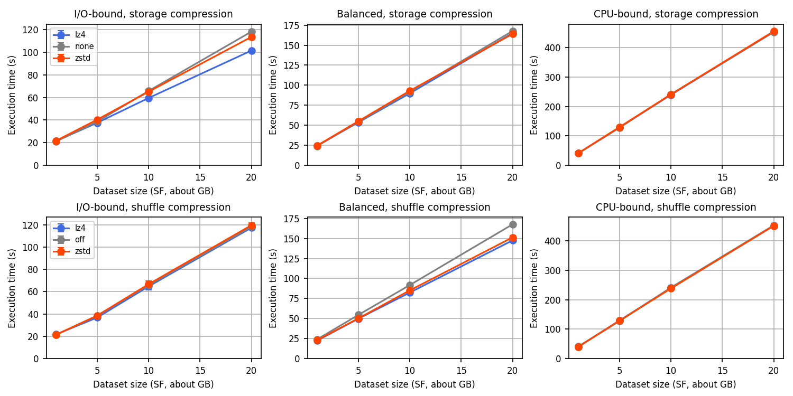
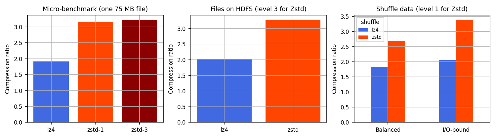
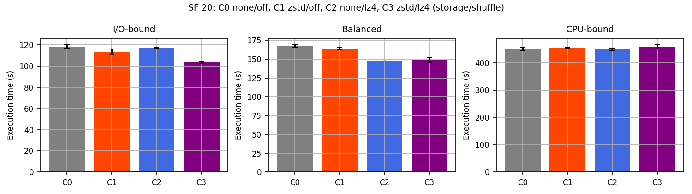
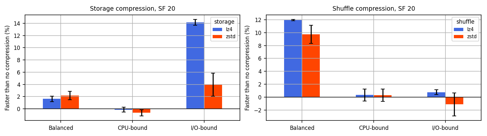

**Group:** *(names)*, USTH / INP-ENSEEIHT, M2 Cloud and Big Data\
**Code, raw measurements and scripts:** repository `CloudBigdataProject`

## 1. Introduction

In this project we studied how data compression changes the performance of a distributed Big Data
framework. Compression makes the data smaller, so less data is read from disk, written to disk and sent over
the network, but the CPU has to compress and decompress it. The goal is to measure when this trade is
worth it.

Following the assignment, we compressed data at two levels:

- **storage level**: the input and output files stored in HDFS;
- **communication level**: the intermediate data exchanged between tasks during the Spark *shuffle*.

Our choices for the parts left open by the assignment:

- **Framework:** Apache Spark (standalone mode) on HDFS. Spark lets us set the shuffle compression
  separately from the file compression, and its History Server gives the CPU time and shuffle metrics of
  every job.
- **Infrastructure:** a cluster of 8 virtual machines on AWS EC2, created and configured with Terraform and
  Ansible.
- **Applications:** three Spark jobs written in Java: one I/O-bound, one CPU-bound and one balanced.
- **Algorithms:** two of the four proposed codecs, **LZ4** and **Zstd**, compared with no compression. They
  are the two ends of the trade-off (LZ4 is fast but compresses less, Zstd compresses more but costs more
  CPU) and both can be used for files and for the shuffle.
- **Data sizes:** 1, 5, 10 and 20 GB of generated text data.

Every configuration was run 3 times, for a total of 216 runs on the cluster.

## 2. Experimental infrastructure

The cluster has 8 `m7i-flex.large` machines (2 vCPU, 8 GB of RAM, 100 GB gp3 disk) in one availability
zone of the AWS Sydney region. The master runs the HDFS NameNode, the Spark Master, the Spark History Server
and the driver of the jobs. Each of the 7 workers runs an HDFS DataNode and a Spark executor (2 cores, 3 GB).
We use Hadoop 3.4.1 (HDFS only, 3 replicas) and Spark 3.5.5 with their default settings, except the executor
memory (3 GB instead of 1 GB, which made the large datasets spill to disk).

The environment is reproducible: Terraform creates the network, the firewall and the machines, and an Ansible
playbook installs Java, Hadoop and Spark with one script and starts the services. The whole study is run with
four commands from a laptop (`make up`, `make run`, `make fetch`, `make down`), on the same cluster and with
the same configuration for every algorithm.

**Monitoring.** On every machine, `sar` records the CPU, memory, disk and network usage every second. The
Spark History Server gives, for each job, the execution time, the CPU time of all tasks (which includes the
compression work), the size of the shuffle data and the shuffle time.

## 3. Applications and workloads

**Data.** We generate the `orders` and `lineitem` tables of the TPC-H benchmark as text files (columns
separated by `|`). Business data with repeated values compresses like real data, and the two tables can be
joined. SF 1 is about 0.94 GB. Each size is stored three times in HDFS: not compressed, with LZ4 and with
Zstd. Each file is smaller than one HDFS block (128 MB), so every codec gives the same number of tasks.

| Application | Processing | Expected profile |
|---|---|---|
| I/O-bound | sort the whole `lineitem` table by ship date and write it back | all the data is read, shuffled and written, little computation |
| CPU-bound | SHA-256 applied 64 times to every line, largest hash per ship mode | almost no shuffle, time spent hashing |
| Balanced | join `lineitem` and `orders`, revenue and SHA-256 8 times per line, total per customer | large shuffle and significant computation |

Table 1 shows that the applications have the expected profiles. *CPU share* is the CPU time of the tasks
divided by their running time.

| SF 20, no compression | Time | CPU share | CPU busy | I/O wait | Memory | Disk (r+w) | Network | Shuffle |
|---|---|---|---|---|---|---|---|---|
| I/O-bound | 118 s | 0.55 | 63 % | 8.4 % | 28 % | 90.4 GB | 64.2 GB | 17.3 GB |
| Balanced | 168 s | 0.79 | 76 % | 2.2 % | 36 % | 30.6 GB | 20.0 GB | 10.9 GB |
| CPU-bound | 453 s | 0.98 | 82 % | 0.3 % | 18 % | 16.4 GB | 9.1 GB | 0.0 GB |

*Table 1. Workload characterisation (CPU, I/O wait and memory: mean over the 8 machines).*

The CPU-bound job uses the CPU 98 % of its task time and moves very little data. The I/O-bound job moves
the most data (disk and network) and has the highest I/O wait. The balanced job is in between on every
metric. Memory was never a limit (at most 38 % used).

## 4. Compression algorithms

**How compression is enabled.** For storage, the jobs write their files with a Hadoop codec
(`saveAsTextFile(path, Lz4Codec.class)` or `ZStandardCodec`) and Hadoop recognises the codec of a file from
its extension when reading. For the shuffle, Spark is configured with `spark.shuffle.compress=true` and
`spark.io.compression.codec=lz4` or `zstd`. Zstd uses level 3 for files (Hadoop's default) and level 1 for
the shuffle (Spark's default).

**Intrinsic characteristics.** Before the cluster experiments we measured the two codecs alone, on one
machine: one 75 MB `lineitem` file compressed and decompressed in memory on one thread, with the codec
classes of Spark, 5 times (median shown). With one thread and the data in memory, the time is CPU time.

| Codec | Compression ratio | Compression time | Decompression time | Compression speed |
|---|---|---|---|---|
| LZ4 | 1.91 | 0.24 s | 0.10 s | 316 MB/s |
| Zstd level 1 | 3.15 | 0.30 s | 0.10 s | 252 MB/s |
| Zstd level 3 | 3.22 | 0.42 s | 0.12 s | 181 MB/s |

*Table 2. Codec micro-benchmark on 75.8 MB of text.*

Zstd makes the data about 40 % smaller than LZ4. At level 1 it costs only 25 % more CPU to compress, at
level 3 it costs 75 % more. Decompression costs about the same for both.

## 5. Methodology

| Experiment | Storage codec | Shuffle codec |
|---|---|---|
| E1, storage compression | none, LZ4, Zstd | off |
| E2, communication compression | none | off, LZ4, Zstd |
| E3, combined | C0 none/off, C1 Zstd/off, C2 none/LZ4, C3 Zstd/LZ4 | |

For C3 we combined the codec with the best ratio for the data stored on disk and the fastest codec for the
data sent once over the network. C0, C1 and C2 are shared with E1 and E2, so there are 6 configurations,
run for 3 applications, 4 sizes and 3 repetitions: **216 runs**.

For each run, a Python script empties the page cache of every machine (so that the data is really read from
disk), starts `sar`, submits the job, stops `sar` and reads the job metrics from the History Server. The runs
are executed in a random order with a fixed seed, so that a slow period of the cluster does not affect only
one codec. The variation between repetitions is small: 1.3 % of the execution time in median, 5.7 % at
most. The graphs show the mean of the 3 runs, and the error bars the standard deviation.

## 6. Results

### 6.1 Execution time and CPU consumption vs dataset size

| % faster than without compression | SF 1 | SF 5 | SF 10 | SF 20 |
|---|---|---|---|---|
| I/O-bound, files LZ4 / Zstd | −1 / −3 | +3 / −5 | +10 / +1 | **+14** / +4 |
| Balanced, shuffle LZ4 / Zstd | +7 / +5 | +9 / +8 | +10 / +7 | **+12** / +10 |
| Balanced, files LZ4 / Zstd | −2 / −3 | +2 / −1 | +2 / −1 | +2 / +2 |
| I/O-bound, shuffle LZ4 / Zstd | −2 / −1 | +5 / 0 | +2 / −1 | +1 / −1 |
| CPU-bound, all configurations | −1 to +2 | −2 to −1 | 0 to +1 | −1 to 0 |

*Table 3. Effect of compression on the execution time (negative = slower).*

The effect of compression depends on the application. The CPU-bound job changes by 2 % at most. Storage
compression helps only the I/O-bound job and shuffle compression helps only the balanced job. For both, the
gain grows with the size of the data.

### 6.2 Storage-level compression (E1)

| I/O-bound, SF 20 | Time | CPU time | CPU busy | I/O wait | Disk volume | Disk throughput |
|---|---|---|---|---|---|---|
| no compression | 118.2 s | 821 s | 63 % | 8.4 % | 90.4 GB | 765 MB/s |
| LZ4 files | 101.5 s | 927 s | 75 % | 1.6 % | 53.3 GB | 525 MB/s |
| Zstd files | 113.5 s | 1089 s | 75 % | 1.2 % | 39.4 GB | 347 MB/s |

*Table 4. Storage compression for the I/O-bound job (disk: sum over the 8 machines).*

The files on HDFS are 2.0 times smaller with LZ4 and 3.3 times smaller with Zstd (Figure 5), and the disk
volume drops in the same proportion for every job (Figure 4). The extra CPU is the cost of decompressing the
input and compressing the output (Figure 3).

For the I/O-bound job, the output is written 3 times by HDFS and is the bottleneck. With LZ4, 37 GB less disk
I/O costs 106 s of extra CPU spread over 14 cores, and the job is 14 % faster. Zstd saves even more I/O but
costs 268 s of CPU: the I/O wait almost disappears and the CPU becomes the limit, so only 4 % is left. For the
two other jobs, reading fewer bytes does not change the time because reading is not their bottleneck. So the
reduction of disk I/O compensates the CPU cost with LZ4, only partly with Zstd, and not at all for the
balanced and CPU-bound jobs.

### 6.3 Communication-level compression (E2)

| SF 20 | Time | CPU time | Shuffle data | Shuffle time | Network volume | Network throughput |
|---|---|---|---|---|---|---|
| Balanced, off | 167.6 s | 1722 s | 10.9 GB | 28.3 s | 20.0 GB | 119 MB/s |
| Balanced, LZ4 | 147.6 s | 1499 s | 6.0 GB | 15.2 s | 16.2 GB | 110 MB/s |
| Balanced, Zstd | 151.3 s | 1572 s | 4.1 GB | 12.8 s | 14.3 GB | 95 MB/s |
| I/O-bound, off | 118.2 s | 821 s | 17.3 GB | 42.4 s | 64.2 GB | 543 MB/s |
| I/O-bound, LZ4 | 117.3 s | 712 s | 8.3 GB | 19.7 s | 56.1 GB | 479 MB/s |
| I/O-bound, Zstd | 119.5 s | 775 s | 5.1 GB | 13.5 s | 54.6 GB | 457 MB/s |

*Table 5. Shuffle compression (shuffle time: sum over all tasks; network: received by the 8 machines).*

Shuffle compression divides the shuffle data by about 2 (LZ4) or 3 (Zstd). A surprising result is that it
**reduces** the total CPU time, by 6 to 13 %. Spark writes the shuffle records with its Java serializer, which
produces very redundant data, and compressing it with LZ4 costs less CPU than writing and sending twice as
much data (the shuffle time is divided by 2). The tasks almost never wait for remote data (less than 1 s per
job), so the network itself was not the bottleneck.

The balanced job is limited by its CPU, so the CPU saved becomes a 12 % speed-up. The I/O-bound job saves as
much CPU but no time, because its bottleneck is writing its output to HDFS, which shuffle compression does not
change. Shuffle compression was counterproductive in three cases: Zstd for the I/O-bound job at SF 10 and 20
(1 % slower), both codecs for the I/O-bound job at SF 1, and the CPU-bound job, whose tiny shuffle (about
100 bytes per task) becomes larger once compressed.

### 6.4 Compression ratio and combined compression (E3)

The ratios measured on the cluster match the micro-benchmark (Figure 5). Combining both levels (C3) does not
add the two gains (Figure 6). For the I/O-bound job, C3 is the fastest configuration (−13 %), because the
CPU saved by shuffle compression compensates the cost of the Zstd files. For the balanced job, C3 is up to
2.5 % slower than C2 (shuffle compression only) from SF 5 to SF 20, and for the CPU-bound job C3 is the slowest
configuration (+1.5 %): it pays both costs and gains nothing.

### 6.5 Execution time vs workload type

Each application gains only at the level where its bottleneck is: the I/O-bound job from storage
compression, the balanced job from shuffle compression, and the CPU-bound job from neither.

## 7. Answers to the questions of the assignment

**1. Which algorithm gives the best trade-off between compression ratio and CPU overhead?** LZ4 has the lowest
CPU cost and was the fastest choice in our experiments, because the disks and the network of the cluster were
not saturated. Zstd removes about 40 % more bytes for 25 % (level 1) to 75 % (level 3) more compression CPU;
it is the better choice when disk or network capacity is the limit.

**2. Does compression always improve I/O-bound applications?** No. Storage compression with LZ4 makes the
I/O-bound job 14 % faster at 20 GB but only 4 % with Zstd, shuffle compression does not change it, and at
1 GB every configuration is slightly slower. The compressed bytes must be those of the bottleneck and the
codec must be cheap enough.

**3. How does compression affect CPU-bound applications?** It brings nothing: all configurations stay within
2 %, and combining both levels is the slowest (+1.5 %).

**4. How do the benefits evolve with the dataset size?** They grow. At 1 GB the fixed costs dominate and
storage compression is slightly harmful; the gains appear from 5 to 10 GB and are the largest at 20 GB. The
ranking also changes with the size: for the I/O-bound job, no compression is the fastest at SF 1, LZ4 from
SF 5, and Zstd becomes faster than no compression only from SF 10.

**5. Storage or network?** It depends on the job. The largest gain came from storage compression for the
I/O-bound job (14 %), whose output is written three times. Shuffle compression helped the balanced job
(12 %), reduced the CPU time of every job with a large shuffle, and never cost more than 2 %, so it is the
safer default.

**6. Can combining both levels degrade performance?** Yes, slightly: up to 2.5 % slower than the best single
level for the balanced job, and the slowest configuration for the CPU-bound job.

**7. When should compression be disabled?** For small datasets, for CPU-bound jobs, when the data to compress
is tiny (the CPU-bound shuffle grew), and when the CPU is already the bottleneck, where a more expensive codec
(Zstd for the I/O-bound files) turns the bytes saved into time lost.

## 8. Conclusion

Compression is not free and not always useful. On our 8-machine Spark cluster it reduced the execution time by
up to 14 % when it removed data from the real bottleneck of the job: the replicated output of the I/O-bound
job, or the shuffle of the balanced join. It brought nothing, or cost a little, for the CPU-bound job and for
small datasets. LZ4 was the best choice on this cluster, while Zstd compresses much more for a moderate CPU
cost and would be preferable where disk or network are slower. Shuffle compression even reduced the CPU time,
because moving uncompressed serialized data costs more than compressing it.
